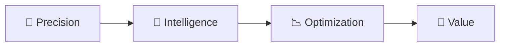

  

<h3 align="center">Construction Cost Management & Quantity Surveying</h3>

  <i>Measurement is the beginning of... everything!</i>

  
  
  
  

  
  
  
  

---

## 🏢 About DIMSCALE

**DIMSCALE** helps developers, investors, architects and project owners **estimate, control and optimise construction costs from design to completion**.

Founded in 2010 by architect Artur Sousa, DIMSCALE created the pioneering concept of **Architecture Cost Management®**: a team of architects and cost management specialists who look after each client's investment as if it were their own. We bring together **Architecture + Construction + Economics + Sustainability** to deliver smarter solutions for a more efficient and sustainable built environment.

From Lisbon to the Algarve, and beyond, we work locally and internationally, adapting to the needs of each project.

> **Better decisions. Greater value. Sustainable projects.**

---

## 🛠️ Technologies

  
  
  
  
  
  
  

**Applied AI** — we use AI where it adds real value to cost management: reading and classifying project documents, automating quantity take-offs, comparing materials and suppliers, and turning historical cost data into faster, better-grounded estimates. Every result is reviewed by our cost specialists.

---

## 🎯 Our Core Expertise

| | Area | What we do |
|:-:|---|---|
| 📐 | **BIM+ & Digital Workflows** | openBIM (IFC) standards and BIM+ integration for automated quantity take-offs (QTO) and seamless coordination between design and financial management. |
| 💶 | **Cost Management & Engineering** | Structured cost planning, budget analysis, and rigorous financial monitoring across all project phases. |
| 📏 | **Estimation & Measurement** | Reliable quantity measurement and precise cost estimation for a clear view of scope and financial requirements. |
| 📉 | **Cost Optimization & Value Engineering** | Identifying cost-saving opportunities while respecting design intent, technical requirements, and project vision. |
| 🤖 | **Smart Tools & Data-Driven Insights** | Internal AI tools, structured cost data, and analytical thinking to support data-driven decisions. |

---

## 🧭 Our Approach

- **Precision** — Establishing a reliable, data-backed basis for cost assessment.
- **Intelligence** — Transforming technical and financial data into strategic insight.
- **Optimization** — Identifying opportunities to improve cost efficiency and project value.
- **Value** — Supporting decisions that balance cost, quality, and design intent.

---

## 🤝 Who We Support

- 🏛️ Architects and architectural practices
- 💼 Real estate developers and investors
- 🏗️ Construction companies and contractors
- 📋 Project managers and cost consultants
- 🧩 Design, engineering, and BIM coordination teams

---

## 📬 Enquiries & Contact

For business enquiries, collaboration, and further information, please visit **[www.dimscale.com](https://www.dimscale.com/)** or write to **[backoffice@dimscale.com](mailto:backoffice@dimscale.com)**.

  

  © DIMSCALE® — Architecture Cost Management. 
  <i>Public-facing company profile. Internal systems, development repositories, and proprietary algorithms are maintained securely in private environments.</i>

